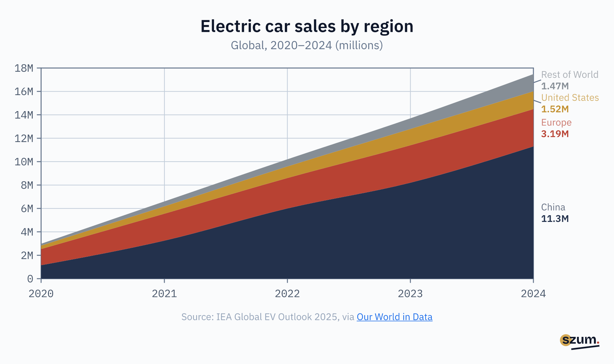

# @szum-io/sdk

Official TypeScript SDK for [Szum](https://szum.io), a chart image API.

Turn a JSON chart request into an SVG, PNG or interactive embed. Use it in transactional emails, weekly digests, PDF reports, Slack messages, dashboards – anywhere an `` tag works. No headless browser, no canvas, no client-side JavaScript.



## Install

```bash
npm install @szum-io/sdk
```

Requires Node.js 24 or newer.

> **Server-side only.** The authenticated `Szum` client sends your API key on every request. Never import it into browser code – save charts server-side and pass the URLs to the client. The standalone `validateChart` function is anonymous, but the package is distributed for server use.

## Quick start

```typescript
import { Szum, type ChartDocument } from "@szum-io/sdk";

const szum = new Szum({ apiKey: process.env.SZUM_KEY! });

const request = {
  config: {
    type: "column",
    theme: "editorial",
    title: "Quarterly Revenue",
    subtitle: "By region, FY 2025",
    category: { field: "quarter" },
    values: {
      type: "long",
      field: "revenue",
      series: { field: "region" },
    },
  },
  data: [
    { quarter: "Q1", revenue: 4.2, region: "Americas" },
    { quarter: "Q2", revenue: 5.1, region: "Americas" },
    { quarter: "Q1", revenue: 2.1, region: "EMEA" },
    { quarter: "Q2", revenue: 2.8, region: "EMEA" },
  ],
  output: { format: "png" },
} satisfies ChartDocument;

const png = await szum.render(request);
```

Use `renderWithMetadata` when you also need diagnostics, usage and font-fallback information:

```typescript
const { data, contentType, fontFallback, diagnostics, usage } =
  await szum.renderWithMetadata(request);
```

`render` keeps its original `Promise<Uint8Array>` return type. `renderWithMetadata` returns the same bytes as `data`, plus `contentType`, `fontFallback`, render `diagnostics`, and `{ used, limit, remaining, overage }` from the render response. Layout findings such as suppressed labels become available during rendering, after semantic validation.

## Validate a chart

Validation is anonymous, free, and side-effect-free:

```typescript
import { validateChart } from "@szum-io/sdk";

const result = await validateChart(request);

if (!result.valid) {
  console.error(
    result.diagnostics.filter(({ severity }) => severity === "error"),
  );
}

if (result.suggestedDocument) {
  // Review before using it for rendering or saving. Revalidate only if edited.
}
```

The result includes one `diagnostics` array and the server's optional `compatibility` report (`exact`, `normalized`, `lossy`, or `unsupported`, with loss codes where applicable). There is no top-level `message` or duplicate `errors` array. Diagnostics use stable coarse codes, JSON Pointer paths and closed code-specific details. Warnings and suggestions can appear on a valid chart. The server emits suggested documents only after complete structural and semantic validation; the SDK validates their wire structure and never applies them automatically.

SDK 4 targets the `2026-09-26` contract and rejects retired validation responses. Applications upgrading from 3.x must adopt the document API described below.

## Saved charts

Save a document server-side and embed the returned short URL in an `` tag, or drop the embed URL into an `<iframe>` for an interactive version:

```typescript
const chart = await szum.charts.create(
  {
    config: {
      type: "column",
      theme: "editorial",
      category: { field: "quarter" },
      values: { type: "long", field: "revenue" },
    },
    data: [
      { quarter: "Q1", revenue: 42 },
      { quarter: "Q2", revenue: 58 },
    ],
    output: { format: "svg" },
  },
  { title: "Quarterly revenue" },
);

// Static image: 
// Interactive embed: <iframe src={chart.embedUrl} />
// Revoke later: await szum.charts.delete(chart.id);
```

`create` returns a **chart object** – `{ id, source, title, createdAt, updatedAt, sizeBytes, publishedAt, imageUrl, embedUrl, documentUrl }` – and the same shape comes back from `get`, `update`, `rename`, and each item of `list`. `imageUrl` (`https://szum.io/c/<id>`) renders the same image on every fetch; append `.png`/`.svg` to force a format. `embedUrl` (`https://szum.io/e/<id>`) serves an interactive HTML page with tooltips, legend toggle, and responsive resize. `publishedAt` is an ISO-8601 timestamp, or `null` when the chart's public URLs are dark (an API-created chart is published on create, so it's set).

### Managing saved charts

Beyond `create` and `delete`, the `charts` resource lets you enumerate and edit:

```typescript
// List your charts, newest first; page via nextCursor
const { items, nextCursor } = await szum.charts.list({ source: "api" });

// Sort and search; `total` is the exact match count (present only with `q`)
const { items: hits, total } = await szum.charts.list({
  sort: "title", // "created" (default), "updated", or "title"
  q: "revenue", // case-insensitive title substring
});

// Read one chart's metadata or complete owner document state
const chart = await szum.charts.get(id);
const { document, draft, publishedAt, title } =
  await szum.charts.getDocumentState(id);

// Read many preview documents in one request (max 100 ids)
const { documents, missing } = await szum.charts.getDocuments([id1, id2]);

// Replace a document in place – same id, same /c/ and /e/ URLs
await szum.charts.update(id, {
  config: {
    type: "column",
    category: { field: "quarter" },
    values: { type: "long", field: "revenue" },
  },
  data: [{ quarter: "Q3", revenue: 64 }],
  output: { format: "svg" },
});

// Rename – metadata only, no document rewrite, same URLs
await szum.charts.rename(id, "Q3 revenue by region");
```

`list` pages via `nextCursor` (pass it back as `cursor`; `null` on the last page). The `cursor` is keyset-coupled to the active `sort`, so keep `sort` stable while paging one result set. Each item also carries `hasDraft` (the chart has unpublished edits). `getDocumentState` returns published and draft document state. `getDocuments` returns `{ documents, missing }`; each `missing` entry carries a `reason` – an open set (currently `"not_found"` or `"unavailable"`), so match the values you handle and treat anything unfamiliar as a non-fatal skip. `"unavailable"` can mean a transient storage problem or unreadable stored data, so a retry is not guaranteed to help.

Batch preview documents prefer the saved draft when one exists. Use `getDocumentState(id).document` when you specifically need the published document. `update` rejects with HTTP `409` while a Studio draft exists; resolve that draft in Studio before replacing the publication through the API.

## Configuration

Axes, color/size legends, and line points accept `true` for default settings, `false` to hide, or a configuration object that enables those settings:

```typescript
import type { ChartConfig } from "@szum-io/sdk";

const config = {
  type: "line",
  category: { field: "month" },
  values: { type: "long", field: "revenue" },
  categoryAxis: { title: "Month" },
  valueAxis: false,
  points: true,
} satisfies ChartConfig;
```

Omission keeps Szum's defaults. Stack totals use `totals: true` or `false` on unnormalized stacked columns and bars. These options have no nested `display` property.

```typescript
const szum = new Szum({
  apiKey: process.env.SZUM_KEY!,
  timeout: 30_000, // ms, default 30s
  maxRetries: 2, // default 2
});
```

Every method accepts transport options as its final argument:

```typescript
const controller = new AbortController();

await szum.render(request, {
  timeout: 60_000, // override client timeout
  signal: controller.signal, // caller-initiated cancellation
});
```

Set `SZUM_DEBUG=true` in your environment to log every request, response status, timing, and retry attempt to stderr.

Safe requests retry `429`, `502`, `503`, `504`, network failures, and a retryable create `409`, honoring `Retry-After`. Metered render requests retry `429` only: a timeout, network failure, or gateway error can happen after a render was committed, so the SDK does not automatically issue a second potentially billable render.

The timeout covers each attempt through the complete response body; retries and their waits can make a call longer than that timeout. Use `signal` to cancel the whole call, including retry waits. `Retry-After` accepts seconds or an HTTP date. Blank create idempotency keys are rejected before sending a request.

## Upgrading from 3.x

Version 4 supports the `2026-09-26` schema. Pass the same complete document to validation, rendering, and saving, with separate `config` and `data`; a 3.x config cannot be made compatible by changing its version string. The SDK fills omitted document/config versions consistently for every action. It does not migrate retained chart definitions. Retrieve a saved chart through `getDocumentState` to obtain the server's current document, or convert an authored definition to the new schema before sending it.

Use `getDocumentState` instead of `getDocument` or `getConfig`, `getDocuments` instead of `getConfigs`, `documentUrl` instead of `configUrl`, and `suggestedDocument` instead of `suggestedConfig`. `ChartConfig` is data-free. Document and nested config versions may be omitted when authoring through the SDK; the SDK fills only those version fields. Presentation omissions and theme overrides remain exactly as supplied.

See the [complete 3.x to 4.0 migration guide](CHANGELOG.md#migration-from-3x) for before-and-after code and every renamed contract.

## Error handling

Errors expose broad transport categories and stable server codes. Match broad handling by subclass, then inspect `code` for operation-specific failures:

```typescript
import {
  Szum,
  SzumError,
  SzumAuthenticationError,
  SzumRateLimitError,
  SzumInvalidRequestError,
  SzumConnectionError,
} from "@szum-io/sdk";

try {
  await szum.render(request);
} catch (err) {
  if (err instanceof SzumAuthenticationError) {
    // 401 – bad or missing API key
  } else if (err instanceof SzumRateLimitError) {
    // 429 – wait err.retryAfter seconds
  } else if (err instanceof SzumInvalidRequestError) {
    // Other 4xx – inspect err.code (invalid_request, not_found, conflict, …)
  } else if (err instanceof SzumConnectionError) {
    // timeout or network error
  } else if (err instanceof SzumError) {
    console.error(err.code); // "api_error", "invalid_request", etc.
    console.error(err.message);
    console.error(err.status); // HTTP status
    console.error(err.retryAfter); // seconds (on 429)
    console.error(err.requestId); // from x-vercel-id – include in support tickets
    console.error(err.diagnostics); // structured chart findings, when present
    console.error(err.failure); // complete validated API failure, including typed details
  }
}
```

All errors serialize cleanly via `JSON.stringify(err)` (they implement `toJSON`), so they work with Sentry, Datadog, and standard loggers.

Server failures use `{ error: { code, message, retryable, details? }, diagnostics?, compatibility?, suggestedDocument? }`. The SDK validates this generated contract and preserves the server's error code. A completed `validateChart()` call returns its validation result even when the chart is invalid; a failure to run the check throws `SzumError`. `retryable: false` prevents retries, while `true` still requires the operation's retry policy to permit them. Metered renders never retry ambiguous failures.

SDK 4 accepts the structured failure envelope above. Older string-error and `issues` envelopes are not treated as current responses. Framework or infrastructure responses that do not match the contract retain HTTP status and a fallback message.

Auto sizing grows up to 4096 logical pixels per axis and lays out the complete dataset inside that bound. Explicit canvas and plot sizes retain their meaning; PNG density changes raster resolution without changing layout. There is no separate Auto-overflow error.

## Exports

| Export                    | Description                                                                                                |
| ------------------------- | ---------------------------------------------------------------------------------------------------------- |
| `Szum`                    | Authenticated client (`render`, `renderWithMetadata`, and the `charts` resource)                           |
| `validateChart`           | Anonymous, side-effect-free chart validation                                                               |
| `SzumOptions`             | Constructor options (`apiKey`, `timeout`, `maxRetries`, …)                                                 |
| `ValidationOptions`       | Validation transport options (`baseUrl`, `timeout`, `maxRetries`, `signal`)                                |
| `RequestOptions`          | Per-call options (`timeout`, `signal`)                                                                     |
| `RenderResult`            | Bytes plus content type, font fallback, and usage metadata                                                 |
| `RenderMetadata`          | Generated content-type, font-fallback, and usage metadata contract                                         |
| `RenderUsage`             | Render meter (`used`, `limit`, `remaining`, `overage`)                                                     |
| `SzumError`               | Base error (`code`, `status`, `message`, `retryAfter`, `requestId`, `diagnostics`, `failure`, `retryable`) |
| `ApiFailure`, `ApiError`  | Generated failure envelope and discriminated operation errors                                              |
| `SzumAuthenticationError` | 401                                                                                                        |
| `SzumPermissionError`     | 403                                                                                                        |
| `SzumInvalidRequestError` | Other 4xx responses, including 400, 404, 409, and 413                                                      |
| `SzumRateLimitError`      | 429                                                                                                        |
| `SzumAPIError`            | 5xx                                                                                                        |
| `SzumConnectionError`     | Timeout / network                                                                                          |
| `ChartConfig`             | Authored config with optional current `version`                                                            |
| `ChartDocument`           | Shared validation, render, and save input with optional current document/config versions                   |
| `ChartConfigInput`        | Generated config contract with required current `version`                                                  |
| `ChartDocumentInput`      | Generated document contract with required current versions                                                 |
| `ChartDiagnostic`         | One structured validation or request diagnostic                                                            |
| `ChartValidationResult`   | Result returned by `validateChart`                                                                         |
| `SavedChart`              | Saved-chart object from `charts.create`/`get`/`update`/`rename`/`list`                                     |
| `SavedChartCreateOptions` | `charts.create` transport options plus optional `title`                                                    |
| `SavedChartDocumentState` | Owner state from `charts.getDocumentState`                                                                 |
| `SavedChartDocuments`     | `charts.getDocuments` result (`documents`, `missing`)                                                      |
| `SavedChartListItem`      | A `charts.list` item: `SavedChart` plus a listing-only `hasDraft` flag                                     |
| `SavedChartListParams`    | Filters and pagination options accepted by `charts.list`                                                   |
| `SavedChartSource`        | Open union of chart origins (`"api"`, `"figma"`, `"app"`, `"mcp"`, …)                                      |
| `SavedChartSort`          | `charts.list` sort order (`"created"`, `"updated"`, `"title"`)                                             |
| `SavedChartPage`          | `charts.list` result (`items`, `nextCursor`, optional `total`)                                             |
| `DocumentMissingReason`   | Open union: why a document was missing (`"not_found"`, `"unavailable"`, …)                                 |
| `SCHEMA_VERSION`          | Schema version this SDK was built against                                                                  |

## Documentation

Full reference at [szum.io/docs](https://szum.io/docs).
